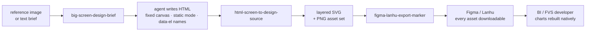

# HTML → Design Source

**Turn a rendered HTML screen into a layered, pixel-verified SVG design source — for Figma, Lanhu (蓝湖), MasterGo, or any hand-off tool.**

[](LICENSE)
[](#skills)
[](../../issues)

Designers can't receive a screenshot. Developers can't build from a picture.
This repo closes that gap: **a screen that already exists as HTML becomes a real design file** —
real text layers, one slice per card / icon / photo, and every asset downloadable.

> Proven on a production 2752×1204 dashboard: 40 cards, 35 icons, 11 charts, a 3-layer China map,
> 191 live text runs, handed to a BI team.
> Outcome: **1.9% pixel diff vs the HTML**, **94 downloadable assets**, **24 MB → 12 MB**.

---

## The problem it solves

A big-screen dashboard usually ships as HTML (hand-written, or generated by an agent).
Then reality hits:

- the design team needs a file they can open, inspect and annotate — they get a PNG
- dev needs slices for cards, icons, photos, charts — they get a full-page screenshot
- nobody can read a spec, because all the text is baked into pixels
- importing the "design source" into Figma quietly breaks: backgrounds vanish, headlines turn
  black, layers can't be selected, exports come out with white boxes

These three skills cover the whole path, and every step is verified with numbers rather than opinions.

---

## Skills

| Skill | What it does | Use it when |
| --- | --- | --- |
| **[big-screen-design-brief](big-screen-design-brief/)** | Turns a reference image (or a text brief) into an agent-ready spec: element inventory → four-way classification (**CSS / vector / AI-generated image / data chart**) → brief + image prompts, plus a **visual-quality bar** (glow discipline, type scale, depth, spacing rhythm) | A designer says "make it look like this" and needs a sliceable *and good-looking* screen |
| **[html-screen-to-design-source](html-screen-to-design-source/)** | Freezes the page, measures the DOM, slices by element type, assembles a layered SVG, verifies it pixel by pixel, audits design-tool compatibility | You have the HTML and need a design source + downloadable slices |
| **[figma-lanhu-export-marker](figma-lanhu-export-marker/)** | Figma plugin + manifest generator: batch-organize layers and mark **every instance** of every asset for export before uploading to Lanhu | Imports land in Figma, but only a handful of images are downloadable |
| **[agent-table-dedup](agent-table-dedup/)** | Make an agent reliably find duplicate keys across many Excel/CSV files: copy-paste prompt + 60-second verification checklist + trap test files. Guards against silent under-read, 20-digit precision loss, lost leading zeros, and false "dedupe" that deletes real rows | "Help me find duplicate invoice numbers across these sheets" — and you need the result to be auditable, not just fast |
| **[sql-standard](sql-standard/)** | Data-governance-grade SQL standard plus a zero-dependency gate: 17 database-agnostic rules plus a Doris dialect profile (21 in total), MySQL/Postgres tables in the dialect cheat-sheet, a delivery contract (purpose / caliber / reconciliation) and three templates (KPI · drill-down · latest-record). Blocks the errors that return wrong numbers without erroring | Any SQL is about to ship — report datasets, drill-downs, batch jobs, ad-hoc queries. Exit code doubles as a commit hook |
| **[image-to-editable-fvs](image-to-editable-fvs/)** | Reference screenshot → FVS that keeps its numbers alive: the original image becomes the visual base, chart regions are erased and native charts are overlaid. Measured 0.87 similarity with every chart editable, one real project end to end | "Make the dashboard look exactly like this picture, but let me change the data" — without rebuilding the layout by hand |



> **Model requirement**: the skills that take a reference image — `big-screen-design-brief`,
> `html-screen-to-design-source` (image entry) and `image-to-editable-fvs` — must be driven
> by a **multimodal model with vision + OCR**. A text-only model will fabricate copy and
> coordinates. The pure HTML → design-source path has no such requirement.

A separate, lighter skill sits outside that pipeline: **agent-table-dedup** makes an agent
reliably find duplicate keys across spreadsheets — prompt template, verification checklist,
and trap files, no web tool required.

---

## 30-second start

```bash
# this repo is a collection: one folder per skill
git clone https://github.com/xueyue88888888-arch/xueyue_sklls ~/skills-src
cd ~/skills-src && ./install.ps1        # Windows — syncs every skill into the local agent
# ./install.sh                          # macOS / Linux
```

Or install a single skill through a skills registry:

```bash
npx skills add xueyue88888888-arch/xueyue_sklls@html-screen-to-design-source
```

Then just talk to your agent:

> Use **html-screen-to-design-source** on this screen: HTML at `page/index.html`,
> cut assets at `assets/`, canvas `2752×1204`.

Requirements for the slicing skill: `pip install playwright numpy pillow` and a Chromium/Edge binary.

---

## Why HTML first (even for FineReport / FVS)

If a client asks for a **FineReport FVS / FineVis / BI big screen**, don't hand-author it by
describing panels. Write HTML first:

1. **Writing HTML is what a general agent does best** — and HTML renders for real, so it can be
   measured and diffed.
2. **HTML → SVG → annotation** is mechanical; the hard thinking stays in the design.
3. The developer then rebuilds panels from specs, and **charts are rebuilt with native FVS
   components** — the design source's charts are placeholders that only fix position and size.

The division of labour is written into both skills so nobody expects a runnable FVS file:

| Stage | Owner | Output |
| --- | --- | --- |
| Design | agent writes HTML | `index.html` (fixed canvas, static mode) |
| Slicing / specs | `html-screen-to-design-source` | layered SVG + PNG asset set |
| Review | Lanhu / Figma | selectable, annotatable design source |
| Build | FVS / BI developer | panels rebuilt; charts native |

---

## Numbers from the real delivery

| Metric | Value |
| --- | --- |
| Pixel diff vs HTML (same font baseline) | **1.91%** overall · **0.59%** outside text |
| Text placement | median < 2px, most runs at (0, 0) |
| Exportable assets | **94 instances** across **61 classes** (16 identical cards reused one slice) |
| File size | 24.3 MB → **12.2 MB** after dropping duplicate `xlink:href` payloads |
| Asset traceability | 104 image layers → 79 unique files, **0 unmatched** |

The biggest wins came from *not* doing things: skipping 16 redundant slices, skipping hand-placed
coordinates, skipping a mask that would have made Figma drop the background entirely.

---

## Repo layout

```
skills/
├── big-screen-design-brief/       # upstream: reference image → brief
│   ├── SKILL.md
│   └── references/                # asset classification · AI image prompts · visual quality bar
├── html-screen-to-design-source/  # middle: HTML or reference image → layered design source
│   ├── SKILL.md                   # includes the 3.6 / 3.7 acceptance gates
│   ├── scripts/                   # preflight · measure · slice · assemble · semantics · charts · verify · compat
│   └── references/                # layer spec · pipeline gaps · semantic layering · pitfalls · compatibility matrix
├── figma-lanhu-export-marker/     # downstream: mark everything exportable
│   ├── SKILL.md
│   ├── plugin/                    # Figma plugin (v6, manifest-driven)
│   └── scripts/                   # build_manifest.py
├── image-to-editable-fvs/         # last mile: reference image → FVS whose charts stay editable
│   ├── SKILL.md
│   ├── scripts/                   # erase-chart-regions.cjs · merge-editable-fvs.cjs
│   └── references/                # measured case
├── agent-table-dedup/             # standalone: reliable agent-based spreadsheet dedup
│   ├── SKILL.md                   # prompt templates + verification checklist
│   └── references/                # trap test cases
├── sql-standard/                  # standalone: data-governance SQL gate
│   ├── SKILL.md
│   ├── rules/                     # 17 database-agnostic + Doris dialect profile
│   ├── templates/                 # KPI · drill-down · latest-record
│   ├── cases/                     # one must-fail per rule, plus a must-pass
│   └── bin/                       # sqlguard.py · selftest.py
├── install.ps1 / install.sh       # sync skills into the local agent directory
└── .github/workflows/validate.yml # CI: frontmatter · py_compile · node --check · size guard
```

---

## Roadmap

- [x] HTML → design source with pixel verification
- [x] Reference image → four-way asset classification (CSS / vector / AI image / chart)
- [x] Visual-quality bar for dark dashboards (single focus, 3-tier luminance, glow limits, type scale)
- [x] Figma plugin: manifest-driven, marks every instance
- [ ] Lanhu upload + annotation acceptance checklist
- [ ] Chart.js / Highcharts adapters for `slice_charts.py`
- [ ] MasterGo / Pixso compatibility matrix
- [ ] `design-qa` skill: score a finished screen against the spec

Ideas and PRs welcome — open an issue with the screen you're trying to ship.

---

## Contributing

Each skill is a folder with a `SKILL.md`. To add one: create the folder, write the
frontmatter (`name` must equal the folder name), add it to the table above, open a PR.
CI checks frontmatter completeness, Python syntax, plugin JS syntax, and blocks files over 1 MB.

---

## License

MIT — see [LICENSE](LICENSE). Use it commercially, fork it, ship it.

<details>
<summary><b>中文说明（点击展开）</b></summary>

### 这是什么

把**已经渲染出来的 HTML 大屏**，变成**可交付的设计源**：分层 SVG + 全套切图 PNG + 可点选可标注的稿件。
给设计师用、给开发用，不给截图。

### 模型要求

吃参考图的那条路（`big-screen-design-brief`、`html-screen-to-design-source` 的图片入口、
`image-to-editable-fvs`）**必须用多模态模型**——能看图、能读图里的文字（OCR）。纯文本模型
会编造文案和坐标，而且下游查不出来。纯 HTML → 设计源这条路不受影响。

### 三个技能

| 技能 | 干什么 | 什么时候用 |
| --- | --- | --- |
| **big-screen-design-brief** | 一张参考图 → 元素清单 → 四分类（CSS / 矢量 / AI 出图 / 数据图表）→ 任务书 + 出图 prompt | 设计师说"就要做成这样" |
| **html-screen-to-design-source** | 静态化 → 量 DOM → 按类型切图 → 合成 SVG → 像素验收 → 工具兼容检查 | 有了 HTML，要出设计源和切图 |
| **figma-lanhu-export-marker** | Figma 插件 + 清单生成器，把每个素材实例都标上可导出 | 导入 Figma 后只有几张图能下载 |

一条链路：

```
参考图/文字需求 → 任务书 → agent 写 HTML → 设计源 SVG → Figma/蓝湖 → 帆软开发还原
```

### 为什么先做 HTML

哪怕目标是帆软 FVS：通用 agent 写 HTML 最强，HTML 能被真实渲染并逐像素验收，
而 HTML → SVG → 标注 是一条已经跑通的机械流程。**图表在设计源里只是占位，开发用 FVS 原生组件重建。**

### 一句话开工

> 用 **html-screen-to-design-source** 处理这个稿：HTML 在 `<路径>`，素材在 `<路径>`，画布 `2752×1204`。

### 一条经验

一张大屏里约 **90% 是 CSS 与矢量**，真正需要 AI 出图的通常只有 **5–7 张**（实景、航拍、产品摆拍）。
先分清这个比例，返工能少一半。

</details>
